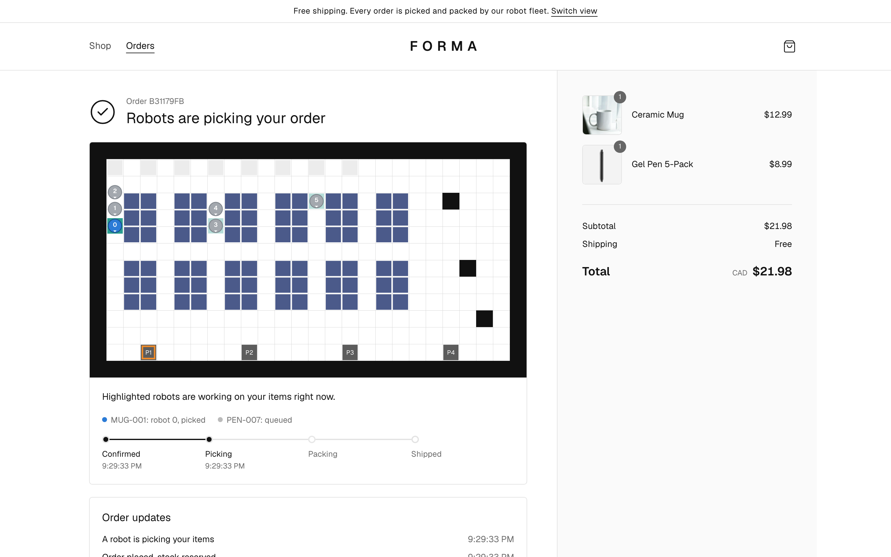
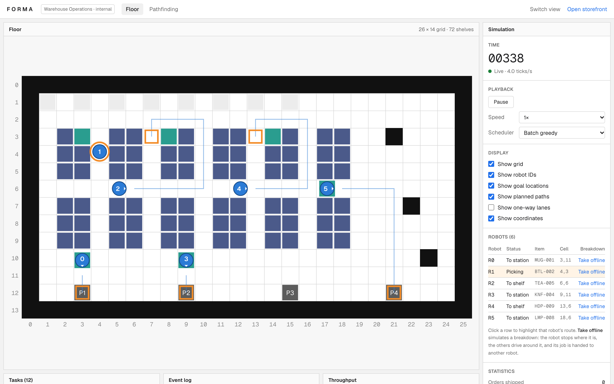
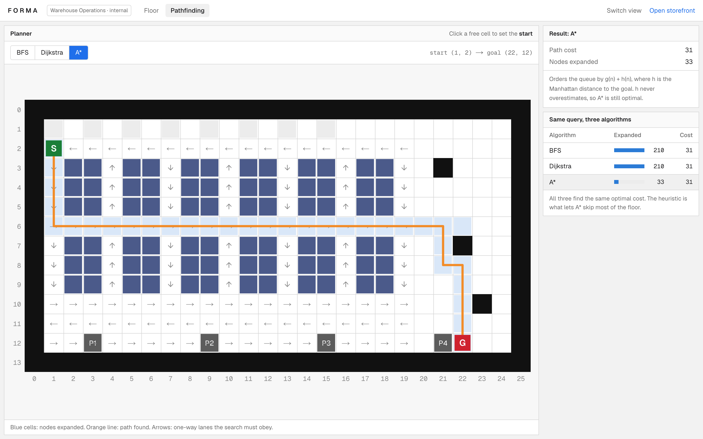
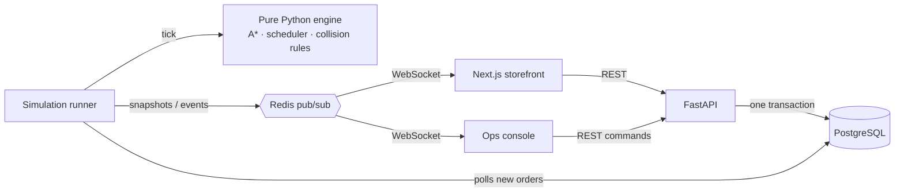

# Forma

[](https://github.com/sydneygahunia-wq/Forma/actions/workflows/ci.yml)

**An e-commerce store whose orders are fulfilled by a simulated fleet of warehouse robots.**

**Live demo: https://forma-ten-bice.vercel.app** (the free-tier API sleeps when idle, so the first load can take up to a minute)

Customers shop and check out on a Next.js storefront. The FastAPI backend reserves inventory in a single transaction, so the last unit can never be sold twice. Each order then becomes pick tasks in a deterministic warehouse simulation, where robots plan routes with A* (implemented from scratch), avoid each other on a 2D grid with one-way aisles, and bring every item to one packing station. Customers and the warehouse team both watch it happen live over WebSocket.

| Store (customers) | Order tracking (customers) |
|---|---|
|  |  |
| **Operations console (internal)** | **Pathfinding lab (internal)** |
|  |  |

## How it works



1. **Checkout** runs `UPDATE inventory SET quantity = quantity - q WHERE … AND quantity >= q` for each line, inside one transaction. The check and the write are atomic, so concurrent buyers can't oversell, and an `Idempotency-Key` under a UNIQUE constraint makes retries safe.
2. **The order row is the queue** (transactional outbox). The simulation polls for undispatched orders, so a crashed simulation re-dispatches unfinished work on restart.
3. **The engine** advances in discrete ticks: assign tasks, then resolve moves (no two robots in a cell and no swaps; the invariant is checked every tick), then run each robot's finite-state machine. It has no I/O, clock or randomness, so runs are reproducible.
4. **Status flows back** to the database and out to every connected browser as full snapshots.

Design details: [docs/ARCHITECTURE.md](docs/ARCHITECTURE.md). Every major trade-off: [docs/DECISIONS.md](docs/DECISIONS.md).

## Measured results

All numbers come from code in this repo, and the simulation numbers are deterministic. Full tables: [docs/BENCHMARKS.md](docs/BENCHMARKS.md).

- **Scheduling:** at high load (6 robots, 0.10 orders/tick, 10 seeds), the `batch_greedy` scheduler cut mean order fulfillment time by **15.7%** versus a FIFO baseline (234.5 → 197.6 ticks). It was faster on **10 of 10** paired seeds at both load levels tested.
- **Pathfinding:** over 1,000 random queries, A* expanded **26.5** nodes on average versus **109.8** for Dijkstra (4.1× fewer), with identical path costs.
- **Concurrency:** 12 simultaneous buyers for the last unit produce exactly 1 order, and 8 racing duplicate requests with one idempotency key produce exactly 1 order. Tested on PostgreSQL 16 and SQLite.
- **Load:** 330 requests in 0.94 s against a single local dev process (p50 43 ms, p95 211 ms), and the inventory ledger balanced exactly.
- **Robustness:** 150 seeded multi-robot runs plus 60 runs with streaming orders and random robot breakdowns all finish with zero collisions.

## Tech stack

| Layer | Technologies |
|---|---|
| Frontend | Next.js 16 (App Router, Cache Components) · React 19 · TypeScript · Tailwind CSS v4 · shadcn/ui (Radix) · TanStack Query · Recharts · SVG rendering |
| Backend | Python 3.12 · FastAPI · Pydantic v2 · SQLAlchemy 2 · Alembic · asyncio · WebSockets |
| Data and messaging | PostgreSQL 16 · Redis pub/sub · SQLite for zero-setup local dev |
| Algorithms | BFS, Dijkstra, A* · priority queues · directed grid graphs · finite-state machines · greedy task assignment · multi-agent collision avoidance · discrete-time simulation |
| Testing | Pytest (unit, property-style, integration, concurrency) · Vitest + Testing Library · Playwright (end to end) · load-test script |
| Tooling | Docker · Docker Compose · GitHub Actions · ruff · mypy · ESLint |

## Run it

Requires Python 3.12+ and Node 20+.

```bash
make setup
```

```bash
make backend
```

```bash
make frontend
```

Open http://localhost:3000 and choose **the store** or **the operations console**. The API docs are at http://localhost:8000/docs. The local setup uses SQLite and runs the simulation inside the API process, so nothing else needs installing.

The full production-style stack runs PostgreSQL, Redis, the API, a separate simulation worker and the web app:

```bash
docker compose up --build
```

## Tests

| Suite | Command | Count |
|---|---|---|
| Backend | `make test-backend` | 65 (86 with `TEST_DATABASE_URL` pointing at Postgres) |
| Frontend unit | `make test-frontend` | 16 |
| End to end | `make e2e` | 5 |
| Lint and types | `make lint` | ruff, mypy, ESLint, tsc |

CI (`.github/workflows/ci.yml`) runs all of these, with Postgres as a service container, and builds the Docker images.

## Known limitations

- **Free-tier hosting.** The live demo runs on Vercel, Render and Neon free tiers (see [docs/DEPLOYMENT.md](docs/DEPLOYMENT.md)). The API sleeps after ~15 idle minutes and takes up to a minute to wake.
- **No authentication on the ops console.** For the public demo this is contained by `DEMO_MODE`: anything a visitor pauses or takes offline heals itself after 2 minutes, stock is restocked, and writes are rate-limited per client.
- **One simulation process.** The engine is single-threaded by design (deterministic). Scaling beyond one warehouse would mean one engine per warehouse.
- `npm audit` flags a `braces` advisory inside Next's ESLint plugin. It's dev-only tooling with no patched release upstream yet. Production dependencies report 0 vulnerabilities, and the Python dependencies pass `pip-audit`.

## Repository layout

```
backend/
  app/simulation/   pure engine: grid, pathfinding, scheduler, engine
  app/services/     orders, catalog, simulation runner, event bus
  app/api/          FastAPI routers (REST + WebSocket)
  app/db/           SQLAlchemy models, session, seed data
  migrations/       Alembic
  scripts/          benchmark.py, load_test.py
frontend/
  src/app/          / (choose a view), /shop, /orders/[id], /dashboard, /pathfinding
  src/components/   store, orders, console, warehouse floor, ui (shadcn)
  e2e/              Playwright
docs/               architecture, decisions, benchmarks, roadmap, journal
```
