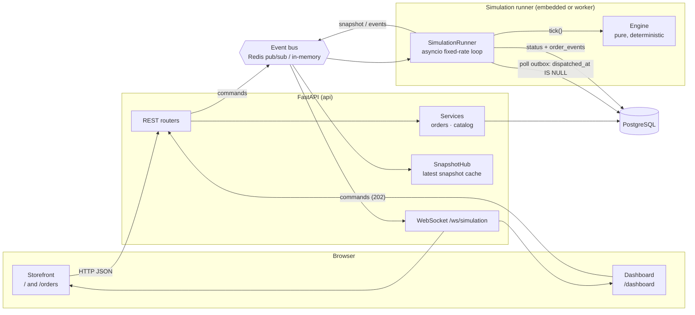
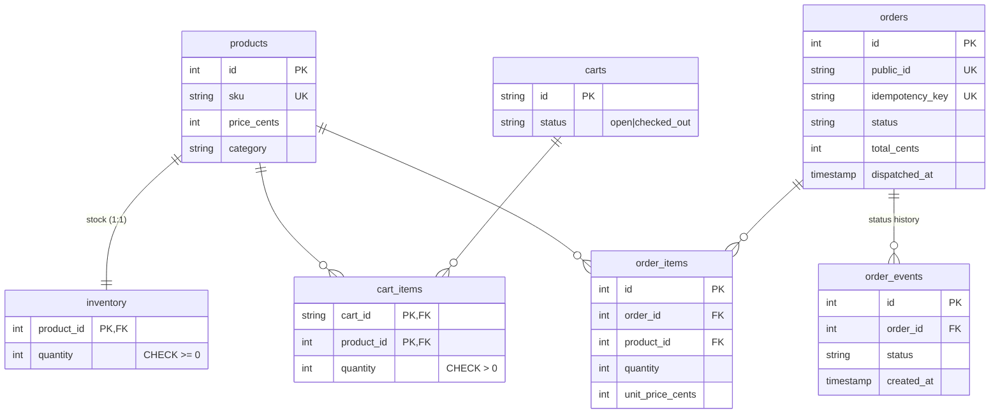

# Architecture

## System overview



There are two deployment modes, chosen with `SIM_MODE`:

| Mode | Processes | Bus | Use |
|---|---|---|---|
| `embedded` (default) | 1: the API runs the simulation loop as an asyncio task | in-memory | local dev, tests |
| `external` | API + `python -m app.worker` | Redis | `docker compose`, horizontally scalable API |

Application code is identical in both modes. The API never calls the simulation directly: commands always go through the bus, and snapshots always come back through it.

## Components

### Simulation engine (`backend/app/simulation/`)

This layer has no I/O, no clock and no randomness. `Simulation.tick()` advances the world by exactly one step:

1. **Assign:** the scheduler pairs available robots with queued tasks. When an order's first item is assigned, the order gets **one** pack station for all its items, chosen by `total travel from its shelves + 15 × undelivered items other orders are sending there`.
2. **Move:** every moving robot proposes its next cell. Conflicts are resolved to a fixpoint: a contested cell goes to the robot already standing there, or else the lowest id, and swaps are cancelled. Moves are only ever cancelled, never added, so the loop terminates in ≤ N rounds. An invariant check raises if two robots ever share a cell.
3. **Arrive:** finite-state-machine transitions: `IDLE → TO_SHELF → PICKING → TO_PACK → DROPPING → RETURNING → IDLE`, plus `OFFLINE` from any state.
4. **Orders:** an order whose tasks are all delivered moves to packing and then shipped.

**Collision avoidance** works in layers, simplest first:

- *Traffic rules:* one-way aisles and cross-aisles (a lane overlay on the layout) prevent head-on conflicts in 1-wide corridors by construction. The layout is tested to be strongly connected, so no cell is a dead end.
- *Execution-time safety:* the move-resolution step above guarantees no vertex or swap conflicts, whatever the planner did.
- *Replanning:* a robot blocked for 2 ticks re-runs A* treating other robots as obstacles. It accepts the detour only if it actually avoids the blocked cell and isn't more than 12 steps longer.
- *Yielding:* if a detour is impossible and the robot ahead wants our cell, the robot with the higher id steps into a free side cell (fixed priority breaks symmetric deadlocks).
- *Failure awareness:* offline robots are walls for planning. If the only route runs through one, robots queue behind it until it's recovered.

**Pathfinding** (`pathfinding.py`): BFS, Dijkstra and A* share one signature and return path, cost and nodes expanded. Dijkstra and A* share a best-first core with lazy deletion and `(f, h, seq)` heap ordering, so ties break deterministically. The Manhattan heuristic is admissible and consistent on a 4-connected grid with costs ≥ 1. `distance_map(reverse=True)` gives distance *to* a cell, which differs from distance *from* it once lanes are one-way.

### Simulation runner (`services/sim_runner.py`)

This bridges the engine to the database and the bus. Each step runs in a worker thread (`asyncio.to_thread`) so synchronous DB I/O never blocks the event loop:

1. Pull up to 100 orders with `dispatched_at IS NULL` (the **transactional outbox**), submit them to the engine, and stamp `dispatched_at`.
2. `engine.tick()`.
3. Persist status changes and `order_events` in one transaction.
4. Publish the events and a full snapshot.

The loop is fixed-rate (`next_at += interval`), so slow ticks don't accumulate drift, and an exception in one tick is logged without killing the loop.

**Crash recovery:** on startup, every non-shipped order gets `dispatched_at` reset, so the fresh, empty engine re-runs it from the start. This is at-least-once dispatch. It's safe because `submit_order` is idempotent per order id and inventory was already settled at checkout. This was verified by killing the live server with 217 orders in flight.

### API (`app/api/`, `app/services/`)

| Endpoint | Notes |
|---|---|
| `GET /api/products`, `GET /api/products/{id}` | One `JOIN` with inventory, no N+1 queries |
| `POST /api/carts`, `GET/PUT/DELETE /api/carts/{id}/items/{pid}` | `PUT` sets the quantity, so it's idempotent. Carts don't reserve stock. |
| `POST /api/orders` | `201` created · `200` + `Idempotent-Replayed` on retry · `409 out_of_stock` / `cart_closed` · `422` validation or idempotency-key reuse |
| `GET /api/orders`, `GET /api/orders/{id}` | Includes the status history |
| `GET /api/warehouse/layout`, `GET /api/simulation/state`, `GET /api/simulation/events` | |
| `POST /api/simulation/commands` | `202 Accepted`: applied asynchronously at the next tick |
| `GET /api/pathfinding/compare?start=x,y&goal=x,y` | Runs all three algorithms |
| `GET /api/metrics`, `GET /api/health` | Health returns `503` if the DB is unreachable |
| `WS /ws/simulation` | Full snapshot on connect, then every tick |

**Order placement** (`services/orders.py`) is the critical section:

```sql
-- per line, in ascending product_id order (consistent lock order => no deadlocks)
UPDATE inventory SET quantity = quantity - :q
 WHERE product_id = :p AND quantity >= :q;      -- 0 rows => 409, whole tx rolls back
UPDATE carts SET status = 'checked_out' WHERE id = :c AND status = 'open';
INSERT INTO orders (..., idempotency_key UNIQUE) ...;
```

The check and the decrement are a single statement, so there's no read-then-write race. Under PostgreSQL READ COMMITTED, a concurrent `UPDATE` on the same row waits for the first to commit and then re-evaluates its `WHERE` against the new value. If two identical idempotent requests race, the loser hits the `UNIQUE` violation and rolls back its own decrements, then returns the winner's order.

## Data model



- Money is integer cents. `unit_price_cents` is copied at purchase so later catalogue edits don't change past orders.
- Stock lives in its own table, so hot writes to inventory never touch catalogue rows.
- `ix_orders_status_dispatched` serves the outbox poll. `order_items.order_id` and `order_events.order_id` are indexed for the joins.
- CHECK constraints (`quantity >= 0`, enum values) make the database the last line of defence.

## Frontend (`frontend/src/`)

- **Routes:** `/` is a landing page where visitors choose a role. Two route groups with their own layouts: `(store)`: `/shop` storefront, `/orders`, `/orders/[id]` (live tracking). `(ops)`: `/dashboard` and `/pathfinding`, wrapped in a `.console` class that swaps the colour tokens. Pages are server components that render client components. Under Cache Components, request-time hooks (`useParams`, `usePathname`) sit inside `<Suspense>`, so each page shell still prerenders statically.
- **Data:** TanStack Query for REST, with optimistic cart updates and rollback on error. `useSimulationFeed` owns the WebSocket: full snapshots, jittered exponential backoff, and polling of `/api/simulation/state` while disconnected.
- **Checkout safety:** one `Idempotency-Key` per checkout attempt, reused across retries. The mutation auto-retries only on network errors, never on 4xx.
- **Rendering:** `WarehouseFloor` is SVG, drawn in the plain style of multi-robot research simulators: a white grid, black obstacles, flat shelf squares, and all robots one colour (grey when idle). Goals are orange squares and carried items are teal squares under the robot. A memoised static layer sits under a dynamic layer of robots, goals, paths, a selected robot's route, and search overlays. Robots animate with a CSS transform transition equal to the tick interval. The same component is used on the landing page, the store hero, the order page, the console and the pathfinding lab.

## Observability

- JSON logs, one object per line, with `request_id` (also returned as `X-Request-ID`), method, path, status and latency.
- Simulation metrics in every snapshot: fulfillment times, utilization, distance, wait ticks, replans, throughput, plus `last_tick_ms`.
- `GET /api/metrics` adds store-side numbers: orders by status, revenue, units in stock.
